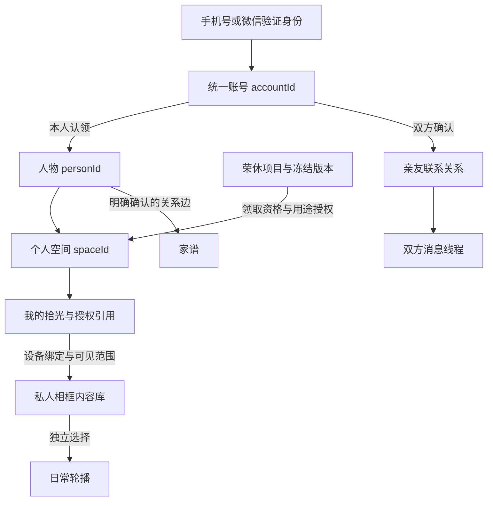

# 账号、内容与同步 PRD

版本：1.1 · 2026-10-21。适用：长者App、共创小程序、统筹管理、日常相框与仪式播放。
性质：补齐当前产品闭环的正式开发基线，非已实现说明。对账号、个人库、设备映射、同步与删除等公共规则具有优先级；不替换仪式章节与现有端内视觉。

配套：[长者App V4](../各端/长者App.md)、[产品总PRD](../总览与公共规则.md)、[相框完整PRD](../各端/相框.md)。所有端遵守同一规则，不各自维护同名用户、关系或素材副本。

## 1. 十条基础约束

1. **一个登录账号，多种业务角色**：App与小程序不各造一套用户ID；相框是授权设备，不是另一个用户。
2. **账号不等于人物**：人物可以未认领、没有账号、已故；名字相同不合并，亲友口述不能直接认领账号。
3. **设备不等于内容归属**：换相框不丢本人库；把相框交给别人不把旧主人内容一起转让。
4. **个人记忆、礼物投稿、日常消息、聊天历史分开**：可共享资产服务，不共享默认可见范围。
5. **我的拾光映射相框，不等于公开轮播**：入库、轮播、发送、仪式四个独立用途。
6. **源记录与视图分开**：照片、声音、相册、书房可引用同一记录，不能复制后失去删除和权限联动。
7. **每次执行都校验当前权限**：建立关系、投递、下载、播放与修改时重新判断，旧链接不永久生效。
8. **收到了、同步了、看过了、回应了是四个状态**：不能一个布尔值代替。
9. **冻结仪式不会被日常更新改写**：新的个人内容和礼后补充进入日常或明确的新版本。
10. **不能承诺离线设备即时擦除**：授权期限、联机撤销优先、缓存加密和设备回执共同约束风险。

## 2. 身份模型与主键

图中每条授权关系都要独立校验。家谱节点或项目角色不产生到个人库的隐含访问路径。

### 2.1 核心对象

| 对象 | 稳定标识 | 含义 | 禁止替代方式 |
| --- | --- | --- | --- |
| Account | accountId | 可登录的自然人账号，统一鉴权主体 | 手机号、微信昵称、案例名 |
| LoginIdentity | identityId＋provider＋providerSubject | 手机验证身份／微信应用身份等 | 将不同应用OpenID直接比较 |
| Person | personId | 被记忆、被送礼或被写入家谱的人物 | 姓名相等自动合并 |
| PersonClaim | claimId | 已验证账号与本人档案关联 | 创建该人物的统筹者直接占有 |
| PersonalSpace | spaceId | 某位人物的本人记忆与获准接收空间 | deviceId或projectId |
| SpaceMembership | membershipId | 本人／协助者对空间的具体权限和期限 | “是家人”就默认管理员 |
| Device | deviceId | 经登记的相框硬件实例 | 设备名称／MAC展示文案 |
| DeviceBinding | bindingId | 某设备当前读写某空间的有效授权 | 给前端传一个recipient名字 |
| GiftProject | projectId | 一次荣休礼筹备与交付 | 个人库、账号生命周期 |
| Connection | connectionId | 两个账号经确认可联系的关系 | 家谱边、投稿关系标签 |
| Family／Kinship | familyId／edgeId | 家谱图及人物之间的有向关系 | 联系许可或账号授权 |

首发一个账号有一个已认领的本人默认空间，可另外有受托空间权限。一个空间可绑定多台私人相框；每台相框同时只对应一个活动空间。多人家庭共享空间或同机多用户切换属于另行设计，不能首发默认混播。

人物合并、账号合并、礼物领取、家谱节点关联是四种独立业务。任何合并都有变更记录与旧ID映射，不能仅改前端对象数组。

### 2.2 App／小程序登录

- App支持真实可用的手机号验证码与配置完成的微信授权；不同渠道身份最终映射到同一accountId。
- 小程序匿名只可看邀请必要简介。保存云端内容、投稿、发消息、申请亲友、建立关系、管理提醒都必须登录；未登录输入可暂存为本机未提交草稿，但不称云保存成功，不自动对外写入。
- 验证手机号证明对号码当前控制权，不证明有权领取任意人物、礼物或相框。
- 微信OpenID按应用作用域保存；UnionID仅在真实取得且配置满足时用于身份关联。无UnionID不能把不同应用账号按昵称或头像合并。
- 已验证的登录身份只能归属一个有效accountId。登录只查询可信身份映射，不让客户端自行指定accountId。
- 对普通App功能不强制同时绑定微信和手机号。解绑身份前确保至少一种可恢复的登录方式；否则先补充并验证替代方式。
- 会话短期访问令牌、刷新令牌和设备凭据分别管理；设备同步不能长期使用从手机复制来的用户Token。

### 2.3 同一人已经有两个账号

触发例：先手机号注册App，后来微信注册小程序；尝试绑定时发现微信属于另一账号。

处理：展示脱敏冲突信息→验证两个身份控制权→解释将合并的个人库、关系、礼物资格和设备→本人明确确认→服务端锁定合并事务→迁移与去重→失效旧会话→返回唯一主账号。验证不齐，不允许“直接覆盖绑定”。

合并规则：

1. 账号层统一身份，保留旧accountId到主账号的不可变审计映射。
2. 原创记录保留recordId、作者历史快照、revision；内容相同不自动删掉两份业务记录。
3. 联系关系按双方主账号去重，最严格的屏蔽／拒收状态优先；不能合并后解除原先拒收。
4. 礼物项目角色按有效授权重算，不因账号合并获得其他受礼者的私库。
5. 两个已认领的不同personId／spaceId不得无条件合并；本人档案认领争议走人工或独立核验。
6. 设备绑定保留设备ID、重发凭据；不超过既定设备限制。任务部分失败需可重试和恢复，不展示半成功后继续写入。

手机号换绑要求当前可用身份再次验证及新号验证；不能只编辑资料字段。被回收号码、身份失窃、无法验证等交由受控找回，不公开列出该号码关联的私人资料。

## 3. 人物认领、荣休礼领取与设备绑定

### 3.1 组织创建人物不等于替长者注册

统筹者创建荣休项目及受礼者草稿personId，可录入获准资料，但不能替长者设置登录密码／冒充微信身份。领取资格由订单／项目授权、有效领取凭证与身份核验共同确定。

长者登录后，若已有本人空间，将新的获准礼物关联到该空间；若没有，完成本人档案确认后创建。两份礼物写着同名老师不自动认为同一个人。确认本人档案不等于打开所有礼前共创素材；未拆封和惊喜模式的访问门槛仍有效。

### 3.2 私人相框绑定步骤

1. 相框未绑定启动只显示品牌、联网和真实绑定方式，不出现案例老师头像与私人照片。
2. 设备向服务端申请短期pairingSession，展示二维码和备用绑定码。
3. App／小程序登录后扫码或输入码，看到设备名、尾号及操作身份。
4. 选择“我本人使用”或明确受托的长者空间；协助者不能把自己的空间误绑定成受礼者。
5. 确认设备用途与权限：本人内容库同步、轮播范围、通知；首次选择默认建议见第5节。
6. 服务端验证设备状态、空间权限、会话有效期并一次性消费；若设备已经绑定他人，不能静默覆盖。
7. 写入bindingId及设备凭据，设备获取真实绑定结果；之后才取得受控内容清单。
8. 若有荣休礼资格，进入领取／下载／主动拆封；没有礼物可进入空白日常库，不阻断个人记录使用。

绑定二维码不是亲友二维码。两者UI与路由必须区分，扫描错误类型给明确说明，不能按码字符串相似度猜用途。绑定重复回调返回同一个结果；取消、超时、断网、过期不写绑定。

### 3.3 多设备与移交

同一spaceId下每台相框有独立bindingId、能力、最近在线、入库范围、轮播列表、提醒策略和同步水位。App展示逐台状态；“全部相框已同步”仅当所有有效目标设备对同一内容revision回执完成。

解除旧绑定先撤销权限，再让新主人完成独立验证。设备出售／送人／换主时不迁移旧主人的私库；新主人不能通过磁盘缓存打开旧内容。无法在线清理的旧机本地必须凭有效离线许可访问，许可到期锁定；平台不承诺即时远程擦除。

协助者授权至少区分设置设备、看设备状态、看内容、编辑家谱；默认仅授予当前操作需要的最小权限。本人可撤销，授权到期终止。组织统筹者、采购者和共创者不因参与礼物自动成为相框管理员。

### 3.4 公共仪式大屏

公共／租借展示设备使用 ceremony_only 会话：只读指定有效礼物版本，有开始结束时间，不获取本人全部记忆、家谱、私信、提醒。仪式结束退出到现场结束页，不能按私人相框规则进入长者日常空间。私人相框仪式结束则在同一授权空间进入日常，不打开另一站点或切固定案例。

## 4. 权限与亲友关系

### 4.1 权限矩阵

| 对象／动作 | 本人 | 经确认亲友 | 项目统筹者 | 设备协助者 | 本人私人相框 | 现场大屏 |
| --- | --- | --- | --- | --- | --- | --- |
| 本人原创拾光 | 读写 | 不默认可读，需单次分享 | 无 | 默认无内容权 | 按绑定范围读／获准编辑 | 无 |
| 本人聊天历史 | 读写／删除 | 无 | 无 | 无 | 不默认同步完整对话 | 无 |
| 荣休冻结包 | 领取条件满足后读 | 按项目预览／作者权限 | 当前项目授权内 | 不自动获得 | 获准包只读 | 指定包限时只读 |
| 日常消息 | 发送／接收本人线程 | 仅自身参与线程 | 无默认权 | 无默认权 | 按本人设备许可 | 无 |
| 家谱 | 管理获准树 | 按树共享授权 | 无 | 需单独授权 | 只读或明确编辑授权 | 无 |
| 提醒 | 创建／修改／完成 | 无默认权 | 无 | 需明确照护授权 | 仅获选提醒执行 | 无 |
| 设备解绑 | 本人＋再验证 | 无 | 无 | 仅显式授权范围 | 本机经本人验证 | 结束自身会话 |

对对象授权需叠加账号状态、关系状态、空间权限、内容用途、设备许可及版本。下载链接签名不是无限期阅读权。

### 4.2 独立添加亲友闭环

没有共创过礼物也可以添加长者。App“我的亲友”右上加好友→我的二维码／分享邀请；小程序提供“添加亲友”入口和扫码／输入邀请方式，不能只藏在礼物项目中。

邀请包含不可枚举token、ownerAccountId内部引用、有效期、撤销状态和用途；公开解析只返回最少的昵称／头像及申请页。二维码图片可保存，但失效后扫描需解释并请长者更新；不能把永久SGX案例码作为生产身份凭据。

申请人登录→确认是认识的人→提交自己的姓名、对长者的关系与可选留言→服务端去重及频率限制→长者收到申请提醒→同意或拒绝→双方关系生效。自述“女儿”不自动成为家谱成员，不能因此读取全部家人资料。

重复申请：已有pending返回原申请；已接受返回已是亲友；已拒绝／被屏蔽按政策限制重新申请。多端同时同意与拒绝以服务器首次有效状态转换为准，另一端刷新状态。旧二维码到期不会撤销已接受关系。

解除关系：停止新发送与排队未投递内容，清晰提示失败；已合法接收的历史按消息保留／撤回规则处理，不假装双方全部记录一起消失。屏蔽优先于新邀请、重要日子和AI建议。被屏蔽状态不向对方暴露不必要细节。

### 4.3 三种“关系”不可混用

- 小程序投稿关系：我是受礼者的学生／同事等，属于该次表达上下文。
- 账号联系关系：是否可互相联系和接收消息，属于Connection及接收偏好。
- 家谱关系：Person之间的父母／子女／配偶等事实与授权，属于Kinship。

三者可关联来源但不能自动互相创建。已投稿不代表长者同意无限期联系；同意联系不代表允许读家谱；家谱人物存在不代表其账号已经认领。

## 5. 内容基础模型与默认同步策略

### 5.1 五个内容域

| 内容域 | 主对象 | 创建与管理 | 同步含义 |
| --- | --- | --- | --- |
| 本人记忆 | MemoryRecord | 本人或获准代录，保留原作者 | 本人空间在不同端的同一记录 |
| 共创投稿 | Contribution | 共创者原稿及用途授权 | 进入获准项目，不自动进入作者全部个人库 |
| 荣休成品 | GiftEdition | 统筹确认、冻结版本 | 按项目资格下载，不可被个人库编辑覆盖 |
| 日常消息 | Message＋Delivery | 发送者正文版本、逐人投递 | 收件空间／线程获准引用，不改变源作者 |
| 聊天与任务 | Conversation＋Task | 当前账号私有 | 历史和任务恢复，不默认下发相框日常轮播 |

`Asset`保存原文件与预览／转码等衍生件；`ContentReference`表示哪里引用哪个版本、为何有权显示。一个物理文件可复用，但记录、消息、授权和作者不得跟着去重掉。

### 5.2 本人新拾光的默认流程

本版补充方案：保存到本人空间即进入云端个人库；首次绑定私人相框时，明确确认“在这台相框中查看我的拾光”，可选择全部类型或部分类型。后续本人的普通新记录遵循此绑定范围自动入库同步，无需每次“发给相框”。

但以下默认不进入相框：未提交草稿、私密标记内容、完整AI聊天、未确认整理候选、受限第三方素材、无资格礼物内容、提醒正文（除非选择相框提醒）。设为私密的记录不能因设备选择“全部”而绕过排除。

首次同步选择不会自动勾选环境轮播。入库后用户可对记录或一个明确的集合选择“加入相框轮播”；该集合如采用“以后新增也加入”，须有独立可见设置与作用范围。禁止静默把所有新照片作为照片墙公开展示。

无相框时正常保存，状态是已保存，不是设备失败；后续绑定按新授权范围做首次快照同步。解除所有设备也不删除个人库。

### 5.3 逐条显示设置

建议详情字段：账号内可见、在我的相框中可见（设备范围）、加入轮播（设备范围）、是否私密。对普通长者界面合并成可读的“相框显示”入口，内部仍分权限与播放策略。

将入库可见关闭：撤回目标设备的引用与缓存访问，不删除云端本人原件；把轮播关闭：仅移出轮播，详情和书房仍可看。恢复可见需重新下发当前有效版本，不能恢复旧失效授权。

## 6. 我的拾光 → 日常相框的类型映射

保持相框已有入口，不另造和App一模一样的菜单。映射到现有“时光碎片／个人书房／相册／留声机／故事”等视图，显示名由相框页面规范统一。

| App内容 | 相框主要落位 | 其他可引用视图 | 默认播放与显示 |
| --- | --- | --- | --- |
| 单张／多张照片 | 时光碎片照片条目 | 个人书房相册；获准轮播 | 原比例可查看，轮播独立授权，不裁掉主体作唯一版本 |
| 照片＋描述 | 同一条碎片，图文关联 | 相册详情、故事引用 | 保留每图说明和作者，不把描述拆成陌生独立故事 |
| 照片＋原声 | 同一条碎片含播放按钮 | 相册详情、留声机引用 | 点按才播放原声；环境轮播默认静音 |
| 纯声音 | 留声机／声音条目 | 时光碎片声音筛选 | 显示标题、时长、原声／合成标识；不伪造一张人生照片 |
| 本人口述转写 | 碎片详情原声＋转写 | 经本人采用的整理稿可进故事阅读 | 转写与整理稿分层，能回到原声 |
| 普通文字回忆 | 时光碎片文字条目 | 个人故事／书房作品引用 | 阅读分页、字号可调；未成作品不自动变成长篇传记 |
| 外部文章 | 个人书房的文章／阅读入口 | “我的拾光”文章视图 | 标题、作者／来源、正文；可TTS，但不是作者原声 |
| 自己朗读的文章 | 文章与本人录音的组合引用 | 留声机和文章阅读 | 可听原录音，可单独读原文，不替换原文章作者 |
| 视频 | 时光碎片视频条目 | 相册／书房视频视图 | 封面与时长，点按播放；自动轮播视频为显式设备设置 |
| 混合媒体记录 | 一个memoryId，带多个asset关系 | 各分类均引用 | 各入口不重复累计一条记忆；局部失败可看其他部分 |
| 家谱资料 | 家庭空间／家谱 | 获准人物详情 | 同一personId和edgeId；不当照片轮播素材 |
| 提醒 | 设备提醒层／提醒管理 | 不进入碎片或作品 | 仅获选occurrence；不混成亲友来信 |

外部文章暂不映射为相框“人生故事”；AI可另生成有来源的摘要候选，但不改原文。无封面时使用中性类型封面，不生成仿真家庭场景冒充真实记录。

### 6.1 字段保真

同步必须包含recordId、spaceId、作者、sourceType、sourceId、revision、assetId、正文类型、关联语音／转写、日期精度、确认标签、权限、设备用途与删除状态。没有来源时不补成“来自陈老师”。App编辑日期与相框显示日期相同，时区处理不能将“只知道1998年”变成另一日。

### 6.2 相框 → App 的反向映射

相框录音、拍摄或文字创作，经本人确认保存后生成同类MemoryRecord，来源标识为frame、创建设备ID保留；App我的拾光可见，分类按真实媒体类型。相框内草稿未确认不自动写入App公开列表，可作为同账号草稿恢复能力单独授权。

相框对本人记录改标题、修订文字、调整确认日期，提交新revision；App增量同步更新同一条。相框只移出自己轮播不删除App原件。相框编辑礼物只读照片的说明时，新增本人批注，不覆盖投稿作者原文。

### 6.3 来信收藏与礼物引用

亲友发来的内容默认在消息，用户主动收藏才进入个人库的来源引用。引用必须保留发送者及消息ID；私信收藏不等于可再转发，转发需要对应用途授权。

荣休包正式打开后，可在私人空间展示礼物专题及获准照片／故事／祝福引用，整个冻结礼物与集体信仍有独立入口。不会因为App照片筛选而丢掉信，也不因为个人库排序改变仪式顺序。私人新内容不得流回统筹工作台作为可自由使用素材。

## 7. 排序、图组与计数

### 7.1 三种排序

- App我的拾光列表：默认保存时间倒序，可筛选，显示真实保存时间。
- 相框日常回忆浏览：可按确认的事件时间从早到晚，未知时间放后；用户选择的播放列表有独立position。
- 荣休仪式：使用统筹确认并冻结的顺序，相框不得按下载顺序、文件名或最新编辑时间重排。

记录时间数据包含originalTimeText、precision（unknown/year/month/day/datetime）、timezone（有需要时）、confirmedBy。为算法使用的排序键不能在UI冒充用户确认的日期。

### 7.2 拼图边界

沿用原规则：先得到最终展示顺序，再检查**连续、同一投稿作者、同一允许时间桶**的照片，最多4张一组；1单图、2双拼、3三图、4四宫格，超过4张拆组。四位不同作者各发一张不自动四宫格；四个人出现在同一张照片里也不是4张。

个人相框默认按单条回忆内已确认顺序组织照片，不自动跨多条独立回忆合并。设备显式启用日常拼图时，使用同作者、同用途、相邻且同确认事件／时间桶的保守规则；未知时间不跨记录自动分桶，不依据人脸推断同事件。具体近似时间阈值保持可配置并待定，不增加未经确认的“前后若干年算同一段”。

例：作者A同一确认事件连续6张→4＋2；A两张、B一张、A一张→2＋1＋1；照片和声音仍按原记录关联。移除组内一张后重算布局，不重排剩余图片、不丢描述、不删除原记录。

### 7.3 计数

全部记忆计memoryId去重；分类允许交叉计数，分类数之和可大于全部数。多个设备下载不会增加记忆数；相框相册和碎片引用同一照片，不生成两份资产计费统计。业务记录数、物理文件数、图组数、仪式章节数分别统计。

## 8. 同步状态、协议与冲突

### 8.1 用户可理解的状态

| 内部状态 | App显示意义 | 不能暗示 |
| --- | --- | --- |
| local_draft | 尚未提交，可继续编辑 | 已保存到账号 |
| saved_local_pending_upload | 已留在设备，等待联网保存到账号 | 云端已安全保存 |
| uploading | 正在上传，可查看任务 | 相框已收到 |
| server_committed | 账号已保存 | 所有相框已下载 |
| pending_device | 等待指定相框同步 | 同步失败或长者已看 |
| device_metadata_ready | 相框已知记录、文件尚在下载 | 可完整离线播放 |
| device_ready | 指定revision及必要文件已校验 | 用户已查看 |
| device_partial | 部分文件不可用 | 整条都丢失／全部可用 |
| failed_retryable | 可重试，保留原内容与原因 | 用户需重新录全部 |
| withdrawn/deleted | 当前用途已不可访问 | 所有离线设备已擦除 |

详情按设备展示最近成功revision、失败项和最后回执时间。主列表可用简洁状态，不暴露接口术语。“已在相框”至少要求该设备返回完整可展示revision与必要资源校验成功。

### 8.2 同步处理顺序

1. 验证账号／设备绑定状态和离线许可；优先处理撤销、删除、用途收缩。
2. 获取serverCursor后的增量元数据；首次使用授权空间快照。
3. 校验record revision与asset清单；下载到临时区并验证哈希、长度和支持格式。
4. 以事务提交新可见revision；失败保留旧的仍获授权版本，不把半包当成功。
5. 更新本地索引和视图，发送设备回执；持久化已应用cursor。重复增量幂等应用。
6. 光标过期走受控重新快照，先执行撤销，不用客户端时间戳猜差异。

事件顺序可能乱序；较旧revision不能覆盖较新revision。删除墓碑有自己的版本，优先于迟到的编辑／上传。处理成功与回执失败时可重报，不重新生成业务记录。

### 8.3 双端编辑冲突

请求携带baseRevision；不采用无条件最后写入覆盖用户正文。互不冲突的独立设备设置可合并；同一正文／日期／删除与修改冲突返回conflict，保留本端候选，展示已更新内容并让本人选择。共享家谱以树或变更集事务校验。

离线修改存待同步候选，联网发现账号切换、设备授权已撤销时不替换成新账号提交。只有本人明确迁移并重新授权才可导入另一空间。

### 8.4 多设备播放与声音

播放进度按用户＋作品／版本保存，设备保持独立即时播放状态；App打开详情不能让客厅相框突然开始播放。朗读、音频、视频默认不跨设备自动“接力”；用户显式选择继续播放才恢复进度。

同一设备最多一个前景音频通道，语音录制优先停播，进入仪式暂停普通轮播声音，退出仪式停止仪式音频。通知不自动朗读亲友隐私正文。

## 9. 删除、移除、撤回与留存

| 操作 | 修改对象 | App结果 | 相框结果 |
| --- | --- | --- | --- |
| 从一台相框轮播移除 | DevicePlaylist引用 | 本人记录仍在 | 仅该设备不轮播，详情可访问 |
| 不在某台相框显示 | 内容对设备的用途授权 | 原件仍在本人库 | 撤回该设备索引与受控缓存 |
| 删除本人拾光 | MemoryRecord墓碑／恢复信息 | 列表删除，按策略可恢复 | 本人目标设备同步删除，非立即远程擦除 |
| 移除收藏来信 | 本人ContentReference | 收藏消失，原线程按权限存在 | 该收藏引用失效，不删发送者原件 |
| 撤回本人已发送消息 | Message撤回版本 | 自己线程显示撤回 | 受影响收件引用、搜索和缓存按撤销处理 |
| 清相框缓存 | 可重新下载文件 | 本人库不变 | 只清已同步缓存，未同步创作保留 |
| 解绑设备 | DeviceBinding | 设备移出有效目标 | 禁止后续访问，清理凭据／私人缓存 |
| 账号注销 | 账号及附属内容处置任务 | 退出、不能继续写入 | 吊销绑定和会话，按确认后的处置范围撤销 |

删除本人源记录与已经向亲友发送的独立消息版本不默认联动：删除页明确“不会撤回已发送消息”；需要撤回必须选择对应发送任务。若原始授权要求源撤回即禁止引用，消息实例仍受授权撤销约束，不能靠复制文件绕过限制。

冻结包不能直接被普通编辑改写，但也不能拒绝合法撤回。撤回先阻断有争议内容的新访问，服务端决定替代包／停用包并保留版本审计；旧包下载设备优先收到撤销清单。离线许可期限、回收站天数和争议处理时限必须冻结后实施，不在PRD中承诺永久保留或秒级擦除。

派生内容（缩略图、转码、转写、AI摘要、向量索引、搜索结果）必须带sourceIds和依赖关系。源数据失效时，全部相应用途索引和派生访问一并失效，不只删除一个列表卡片。

## 10. 提醒与消息的跨端调度

### 10.1 不同事件类型

| 类型 | 对象 | 接收者 | 内容展示 |
| --- | --- | --- | --- |
| 个人事项提醒 | ReminderRule／Occurrence | 本人及显式授权设备 | 根据隐私级别显示事项 |
| 重要日子问候 | PersonDate／Subscription | 已获许可并订阅的亲友 | 引导发问候，不泄露其他日期 |
| 亲友新来信 | Message／Delivery | 收件账号 | 默认通用提示，主动打开正文 |
| 好友申请 | ConnectionRequest | 邀请所属账号 | 申请人与自述关系 |
| 礼物状态 | ProjectEvent | 对应项目有资格的人 | 区分收集结束、成品可看、正式拆封 |
| 设备故障／同步 | DeviceEvent | 本人／设备管理者 | 设备名与处理入口，不混入私人DM |

消息数只统计相应未读对象，不把提醒规则条数当未读私信数量。各渠道共用eventId和去重键，应用内、系统推送、服务号、相框展示各自记录投递结果。服务号能力依赖实际授权与平台配置，不能承诺无限推送。

### 10.2 提醒规则与执行项

规则：事项、timezone、开始日期、当地时间、repeatRule、enabled、设备范围、privacy、revision。执行项：occurrenceId、ruleId、scheduledAt、状态（pending/notified/completed/snoozed/missed/cancelled）、完成者、完成时间、延后时间、channelReceipts。

一次提醒跨设备同一occurrenceId。完成今天只更新执行项；暂停规则取消未来待执行项而不是删除历史；修改规则递增revision，重排未发生执行项，旧通知点击需先检查当前版本，不能再次创建已经取消的事项。

时区策略：默认固定创建时确认的时区；用户出行可主动选择按当地时间迁移，确认受影响的规则。夏令时不存在的当地时刻向后取第一个有效时刻并在确认预览中标明；重复时刻仅执行一次，按首次出现处理。研发需用IANA时区而不是固定UTC偏移计算。

离线相框可缓存已获准且尚有效的近期执行清单；清单有效期和设备时钟偏差阈值待确认，过期不长期自行生成事项。联机后完成／暂停／删除先于重排通知。App没有系统通知权限时可在页内查看，不能显示“保证到点提醒”。不向家属自动发送“没吃药”推断；逾时未点完成不等于用户没执行。

## 11. 工程数据与服务契约

### 11.1 最低字段

| 实体 | 必要字段（可按工程规范命名） |
| --- | --- |
| Account | accountId、status、profileRevision、createdAt |
| LoginIdentity | identityId、accountId、provider、appScope、providerSubject、verifiedAt |
| PersonalSpace | spaceId、ownerPersonId、ownerAccountId、status、revision |
| Membership | principalId、spaceId、scopes、grantedBy、expiresAt、revokedAt |
| MemoryRecord | memoryId、spaceId、creatorAccountId、entryType、title、body、source、eventTime及精度、confirmedTags、visibility、revision、deletedAt |
| Asset | assetId、ownerScope、mime、bytes、hash、duration／dimensions、original、variants、status |
| Reference | refId、sourceType、sourceId、sourceRevision、targetView、purpose、grantId、attribution |
| DeviceBinding | bindingId、deviceId、spaceId、capabilities、scopes、state、credentialVersion、expiresAt |
| DevicePolicy | bindingId、syncTypes、excludedPrivate、playlistRules、notificationPolicy、revision |
| SyncReceipt | deviceId、recordId、revision、requiredAssetStatus、appliedCursor、appliedAt、errorCode |
| Invitation | invitationId、tokenHash、ownerAccountId、purpose、expiresAt、revokedAt |
| ConnectionRequest | requestId、invitationId、requesterAccountId、declaredRelation、message、state、version |
| Connection | connectionId、accountA、accountB、permissions、status、acceptedAt、blockedBy |
| Message／Delivery | messageId、senderId、contentRevision、replyTo、idempotencyKey；recipientId、status、acceptedAt、deliveredAt、readAt、failure |
| FamilyNode／Edge | personId、familyId、linkedAccountId可空；edgeId、from、to、type、validity、confirmedBy、revision |
| Reminder／Occurrence | 第10.2节字段；规则与每次执行不能共用done布尔值 |
| Deletion／MergeJob | jobId、subject、scope、actor、confirmation、state、progress、failure、auditReferences |

服务端时间用于事件排序与审计；用户确认事件日期是独立字段。原型的Blob URL、数组下标、姓名匹配和固定邀请码不能作为生产数据键。

### 11.2 服务语义

| 服务 | 请求重点 | 结果重点 |
| --- | --- | --- |
| 账号登录／绑定身份 | 可信授权码或验证码会话、应用作用域 | accountId、会话、冲突或验证要求 |
| 认领人物／领取礼物 | accountId＋claim凭证＋项目资格 | spaceId／projectGrant，不自动拆封 |
| 设备配对 | pairingSession、目标空间、权限确认 | bindingId、设备凭据、用途范围 |
| 内容上传提交 | uploadId、hash、record draft、幂等键 | committed recordId/revision，未完文件不成功 |
| 增量同步 | device凭据、spaceId、cursor、能力 | 删除／撤销优先增量、清单与新cursor |
| 同步回执 | recordId、revision、校验结果 | 已应用状态，拒绝过期绑定回执 |
| 本人内容更新 | baseRevision＋patch | 新revision或冲突，不能无条件覆盖 |
| 邀请解析／申请 | token、已验证申请人、幂等键 | 最少简介／唯一申请 |
| 接受／解除关系 | 本人身份＋request版本 | Connection状态与受影响任务 |
| 消息发送／回应 | 内容revision、recipientIds、确认、幂等键 | messageId及各收件状态 |
| 提醒调度 | 规则候选确认、timezone、设备范围 | ruleId与下一次执行时间 |
| 访问撤销 | 主体、用途、受影响记录、再验证 | 撤销任务、设备回执，不假装离线即时完成 |

错误至少区分：未登录、无权、对象已撤回、版本冲突、邀请码过期、设备已绑定、身份冲突、格式不支持、容量不足、可重试网络错误、通知权限不足。UI显示可理解操作，不把错误全部变成“请稍后再试”。

### 11.3 隐私、恢复与迁移

账号缓存按accountId／spaceId隔离，退出清令牌和可访问私密视图；本地未同步内容若保留必须加密并在原账号重新认证后恢复。新账号不能自动接管上一人的草稿。

设备下载使用短时受控URL，文件转码、解析与AI访问均校验用途。原始录音和私信正文不进入普通埋点；用于AI处理需遵守明确的服务范围和留存配置。记录服务人员处理争议的最小授权与审计。

原型本地演示数据不自动迁移为生产用户真实记录。若需导入，必须本人登录、展示待导入清单、识别案例／演示来源并确认；陈老师固定树与虚构亲友不能混入新账号。

## 12. 端到端验收矩阵

| ID | 场景 | 预期 |
| --- | --- | --- |
| X01 | 小程序账号登录App | 同一身份映射同accountId，不创建另一份库 |
| X02 | 无UnionID且昵称相同 | 不自动关联，走验证 |
| X03 | 两个既有账号绑定冲突 | 双身份核验、明确合并，不覆盖资产 |
| X04 | 家属扫码替长者设置 | 显式受托空间，不绑成家属本人库 |
| X05 | 设备已属他人 | 阻止覆盖，旧主解除／核验流程 |
| X06 | 未领礼但已注册App | 可保存个人记忆，不强制购买／领取 |
| X07 | 两份同名受礼者档案 | 按资格认领，不凭姓名合并 |
| X08 | 私人相框仪式结束 | 同空间进入日常，信与礼物专题可重看 |
| X09 | 现场大屏仪式结束 | 返回现场结束页，无私信／家谱／私库 |
| X10 | App保存照片＋声音 | 一条记录、两个媒体关联，相框可看可点听 |
| X11 | App收藏外部文章 | 相框书房文章可读，原作者保留，不变成人生故事 |
| X12 | App保存视频 | 支持的框可点播，不支持明确降级；不假报全量成功 |
| X13 | 同记录出现三分类 | 全部数加1，不按分类累计成3 |
| X14 | 私密记录＋设备全部类型 | 不下发，私密规则优先 |
| X15 | 相框入库完成未选轮播 | 库里可见，首页不自动出现 |
| X16 | 两框仅一台允许轮播 | 仅该台播放，另一台保持原列表 |
| X17 | 相框保存原声故事 | App出现同memoryId，不复制成消息 |
| X18 | 相框编辑本人记录 | App更新同revision；并发冲突保留候选 |
| X19 | 四作者同年各一图 | 不自动合成同作者四宫格 |
| X20 | 同作者同事件六图 | 4＋2，原图描述和顺序完整 |
| X21 | 新日常照片同步 | 不改变冻结仪式包与集体信 |
| X22 | 云端成功设备离线 | 显示等待该设备，不能已看过 |
| X23 | 元数据到但文件失败 | 部分／下载中，不device_ready |
| X24 | 增量重复或乱序 | 幂等，无重复记录，无旧版本覆盖 |
| X25 | 删除后旧编辑到达 | 墓碑优先，不复活；恢复需明确动作 |
| X26 | 解绑后拿旧下载URL | 权限失效，不能续传新内容 |
| X27 | 离线框收到撤销后再联网 | 撤销优先于新增，缓存索引一致清理 |
| X28 | 清缓存存在未同步录音 | 保留未同步原件，不自动删除 |
| X29 | 非共创者扫码加长者 | 登录申请与本人审批成立，无项目门槛 |
| X30 | 二维码更新／过期 | 新申请拒绝老码，既有关系不变 |
| X31 | 同时通过与拒绝 | 服务端单一状态，无重复连接 |
| X32 | 家谱女儿无账号 | 可展示不能发送，不绑定同名陌生账号 |
| X33 | 亲友关系通过 | 不暴露全库、家谱和设备管理权 |
| X34 | 发出后从自己库删原记忆 | 消息按明确版本与授权策略处理，UI解释影响 |
| X35 | 收藏对方来信后对方撤回 | 引用授权失效，不靠收藏绕过撤回 |
| X36 | 相框回应App接着聊 | 同线程replyTo，无双份并行记录 |
| X37 | 每天提醒今天完成 | 其他设备同步取消今天，明天继续 |
| X38 | 提醒改时间旧通知被点 | 读最新revision，不执行过时动作 |
| X39 | 系统权限关闭 | 可管理规则但说明通知受限，不伪装到达 |
| X40 | 手机换时区 | 按确认策略执行，不偷偷变更全部规则 |
| X41 | App退出换账号 | 前账号内容、设备与聊天不可访问 |
| X42 | 来源删除 | 转写、缩略图、AI派生、搜索索引按依赖失效 |

## 13. 交付顺序与未定事项

建议研发依赖顺序：统一账号与空间 → 素材及记录版本 → App云保存 → 私人相框绑定与入库 → 类型映射与回执 → 亲友邀请及真实消息 → 双向编辑和删除 → 提醒调度与跨设备完成 → 全页面Agent动作联调。每一阶段可用，但不能把尚未接通环节标成成功。

必须冻结：身份提供方配置及找回方案、代理授权、设备数量限制、容量／文件上限、离线许可时长、回收站期限、撤回处理时限、通知平台能力、提醒静默／重试策略、照片时间桶阈值。以上未确定前采用配置与明确不可用状态，不擅自生成对用户的永久承诺。

当前仓库原型没有真实统一账号、云库、相框增量同步或后台通知；本公共PRD为这些服务提供落地约束。保持现有界面不等于保持原型的数据存储方式。

## 14. Agent公共契约补充

详细执行规格见 [小叙Agent](小叙Agent.md)，案例见 [Agent口述与推荐案例](../验收案例/Agent口述与推荐.md)。本节补齐其跨端对象，权限和同步仍按本文执行。

1. **口述提及与人物实体分离。**mention、Person、家谱关系、账号认领、好友connection分别存储。父母路径未知的孙辈关系可保存为经确认的关系断言，不为画树制造中间代，不直接变成可投递账号。
2. **AI只提交候选。**原声、转写修订、事实账本、整理候选、已采用稿和正式memoryId分别关联来源及revision。明确纠正保留历史，所有依赖该事实的候选、推荐与索引须失效更新。
3. **工具执行统一。**触控、语音、快捷选项与推荐入口调用同一业务服务。操作者与space由认证上下文确定；关键动作绑定对象、用途、内容版本、收件人与确认凭据，超时查询幂等operation。
4. **推荐不是新的共享用途。**个性化输入仅使用本人允许的已确认特征；未确认关系、私信正文、敏感推断及撤回内容不默认进入首页。六卡缓存按账号与空间隔离，删除、撤权与退出立即失效。
5. **多任务分别成功。**保存、家谱提交、发送、轮播设置、提醒调度有各自操作ID和回执；保存成功不能代替其他操作成功。家谱更新不会自动触发人物账号认领，亲友建立也不授权读取全库。
6. **相框承接已确认内容。**AI整理候选不自动进入相框；采用稿更新同一来源revision。原声与合成朗读明确区分；入库、轮播、外发、仪式仍分别授权。
7. **个性化偏好与原内容分离。**不感兴趣／关闭个性化只影响推荐，不删除文章或禁止已有功能；画像中的事实可纠正，不能把模型推断反复引用为已确认事实。
